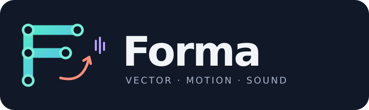

# Forma

Forma ist ein Rust-Desktopeditor mit **`.frm`-Projektdateien** und eingebetteter JavaScript-Runtime für interaktive SVGs. **Aktueller Stand: funktionierender Prototyp, nicht der vollständige Funktionsumfang aus [PLAN.md](PLAN.md).**

## Start

Voraussetzungen: Rust/Cargo mit den Workspace-Abhängigkeiten; für das Desktopfenster eine funktionierende Grafik-/Fensterumgebung. Beim ersten Build lädt Cargo Abhängigkeiten herunter. Node.js und Python 3 werden nur für die Prüfskripte benötigt.

```sh
cd /home/user/svg_editor
cargo run -p forma_editor --bin forma
# Export ohne Desktopfenster:
cargo run -p forma_editor --bin forma -- --demo-export /tmp/forma-demo.svg
```

Der Editor startet mit seiner eigenen Demo. Eine **`.frm`-Datei hereinziehen**, unter **Datei → Öffnen …** (Strg+O, System-Dateidialog) bzw. **Zuletzt geöffnet** wählen oder direkt starten: `cargo run -p forma_editor --bin forma -- examples/demo.frm`. Ungespeicherte Änderungen und Zeichen-/Quelltextentwürfe werden vor einem Wechsel und beim Schließen des Fensters abgefragt; der Fenstertitel zeigt Datei und `•` für ungespeichert. **Speichern** bewahrt das bearbeitbare Projekt; SVG ist nur ein optionaler Export.

**Gestalten / Animieren / Erweitert** trennen Zeichnen, Animation und Code. Auswahl, Pen, Pfadpunkte und Freihand sind exklusive Werkzeuge; zusätzliche Optionen bleiben zugeklappt. **Vorschau**, **Abspielen** und **Forma Viewer öffnen** sind direkt erreichbar. [Bedienung, Gesten und Grenzen](docs/usability.md).

Eigenes JavaScript läuft nur nach ausdrücklicher, sitzungsbezogener Freigabe unter **Erweitert → JavaScript**, nie in der nativen Zeichenfläche. Unter **Animieren → Audio** lässt sich eine begrenzte `ffplay`-Vorschau globaler Audiocues aktivieren; Vorbereitung erfolgt im Hintergrund. Browser-Speech bleibt optional. `forma-cli embed-speech` erzeugt lokal eingebettetes WAV; Wiedergabe benötigt dann keine installierte Stimme.

## Eine Projektdatei: `.frm`

Geometrie, Ebenen, Bones, Keyframes, States, Blend-Gewichte, Variablen, eingebettetes Audio und eigener Code bleiben **zusammen in einer Datei**. Kein zusätzliches JSON/SVG oder Assetverzeichnis nötig. Intern ist `.frm` streng validiertes, lesbares JSON; ältere `.json`/`.forma.json`-Projekte bleiben kompatibel. Die Anwendung/Runtime und installierte Editorplugins sind nicht Teil des Projektfiles. [Format und Kompatibilität](docs/frm-format.md).

Unter **Animieren** führen **Animation einfach erstellen** (Keyframe/Preset) und **Zustandsmaschine einfach erstellen** (Klick/Hover, Sichtbarkeit, Clipstart) durch die ersten Schritte. Gewichtete Mischung und zeitliche Fades bleiben neben den Expertentools erreichbar. [Schritt-für-Schritt und Blend-Grenzen](docs/animation-workflow.md).

```sh
forma-cli new --demo --output scene.frm
forma-cli convert legacy.forma.json --output scene.frm
forma-viewer scene.frm
# Nur für geprüften eigenen Code:
forma-viewer examples/desert-stickfight.frm --trusted-js
```

## Forma Viewer

`cargo build -p forma_viewer` baut die echte native SVG-WebView. Im Editor öffnet **▶ Forma Viewer** einen Snapshot des aktuellen Projekts, inklusive Runtime, States und eingebettetem Audio; die stille resvg-Zeichenfläche bleibt getrennt. Eigenes JS nur nach Freigabe in Advanced. Direkt ohne vorherigen SVG-Export: `cargo run -p forma_viewer --bin forma-viewer -- examples/brown-owl.frm --trusted-js` (mitgelieferten Code vorher prüfen). Bestehende SVGs bleiben ebenfalls unterstützt. Aktive fremde SVGs sind nicht vertrauenswürdig. Linux benötigt GTK3/WebKitGTK; [Details und Tests](crates/forma_viewer/README.md).

SVG-Exporte enthalten **Created with Forma**, Anwendungs-/Schemaversion und maschinenlesbare Generator-Metadaten (`urn:forma:metadata`). Kein sichtbares Wasserzeichen; die Kennzeichnung ist editierbar, kein Echtheitsnachweis.

## Runtime verständlich bedienen

[Runtime-Kochbuch](docs/runtime-cookbook.md): Play/Pause/Neustart, Clip- und globale Uhr, HTML-Einbettung, Audio und Fehlersuche. `forma.snapshot()` zeigt Laufzeitstatus als kopierte JSON-Daten; `forma.reportError(error)` nutzt den einheitlichen Error-Kanal mit begrenzter Historie. Bestehende Transport-/State-APIs bleiben unverändert.

## Browserunabhängige Runtime

`forma_runtime` stellt den Forma-Dokumentkern als native Rust-Runtime, C-ABI (`cdylib`) und `forma-runtime`-JSON-Zeilenprozess bereit. Andere Sprachen können Events senden, Zeit/Clip-Gewichte steuern und ausgewertete Nodes/Bones abrufen. Zeichnen, Eingabetreffer und Audio übernimmt der Host — kein Browser, aber auch kein allgemeiner SVG-JavaScript-Interpreter. [API und Python-Beispiele](docs/native-runtime.md).

```sh
cargo build -p forma_runtime
python3 examples/native-runtime/smoke.py --library target/debug/libforma_runtime.so --binary target/debug/forma-runtime
```

## CLI-Workflow

CLI und Editor verwenden denselben Dokumentkern. CLI-Ergebnisse sind JSON; Fehler stehen als JSON auf stderr (mit `hint` für den nächsten Schritt) und liefern einen Fehlerstatus. Kein KI-Anbieter, API-Key oder Server ist erforderlich.

**Einstieg:** `forma-cli guide` zeigt den kurzen Arbeitsablauf mit getesteten Rezepten. Bearbeitungsbefehle speichern ohne `--output` direkt in die Eingabedatei, `check` findet typische Fehler (verdeckte Formen, Clips, die nie abspielen, unlesbarer Text …) samt ausführbarem Fix, `batch` führt viele Schritte ganz oder gar nicht aus, `clip` verwaltet Clips und `on` macht Formen interaktiv.

```sh
F=/tmp/szene.frm
cargo run -p forma-cli -- new --output $F --width 800 --height 450 --background "#0b1d3a"
cargo run -p forma-cli -- node add $F --kind circle --id sonne --x 400 --y 420 --radius 60 --fill orange --pivot center
cargo run -p forma-cli -- keyframe $F --clip aufgang --target sonne --property y --time 3 --by -260 --easing ease-out --autoplay --loop
cargo run -p forma-cli -- on $F --event click --target sonne --set sonne.fill=gold
cargo run -p forma-cli -- check $F
cargo run -p forma-cli -- render $F --time 1.5 --output /tmp/szene.png
```

Mit JSON und Merge-Patch:

```sh
cargo run -p forma-cli -- new --demo --output /tmp/draft.forma.json
cargo run -p forma-cli -- validate /tmp/draft.forma.json
cargo run -p forma-cli -- inspect /tmp/draft.forma.json
cargo run -p forma-cli -- evaluate /tmp/draft.forma.json --time 0.5
printf '%s\n' '{"name":"Meine Animation"}' > /tmp/forma-patch.json
cargo run -p forma-cli -- apply /tmp/draft.forma.json --patch /tmp/forma-patch.json --output /tmp/final.forma.json
cargo run -p forma-cli -- export /tmp/final.forma.json --output /tmp/final.svg
```

`schema` liefert einen Formatleitfaden mit vollständigen Beispielen, kein formales JSON Schema. `apply` nutzt RFC-7396-Merge-Patch: Arrays werden vollständig ersetzt. `evaluate` führt keine Zustandsaktionen, JS oder Audio aus; nicht automatisch aktive Clips werden dabei nicht abgespielt. Details: [CLI.md](CLI.md), [CORE_API.md](CORE_API.md). Für andere LLMs: [Authoring-Anleitung](LLM.md) und [kopierbarer Prompt](prompts/forma-author.md); `schema` und `capabilities` liefern die tatsächlich unterstützten Features.

## Durchgängiges Offline-Beispiel

- [examples/demo.forma.json](examples/demo.forma.json): editierbares Projekt mit Kreis, dreisekündiger Keyframe-Bewegung, Klick-Zustandswechsel und eingebettetem WAV-Cue bei **1,5 Sekunden globaler Transportzeit**.
- [examples/demo.svg](examples/demo.svg): tatsächlicher CLI-Export mit explizit freigegebenem, kurzem `customJs`-Handler. Ein Kreis-Klick entsperrt Audio und startet die Bewegung samt Transport neu; beim ersten Klick wird der Kreis orange.
- Der Ton ist **0,4 Sekunden synthetischer, silbenartiger Klang, keine gesprochenen Worte**. Er ersetzt nicht die in PLAN.md vorgesehene Sprachaufnahme. PCM-WAV, mono, 8 kHz, 16 Bit; keine externen Audiodateien und keine Sprachsynthese.

```sh
# Reproduzierbar: CLI new --demo → apply → validate → export --trusted-js
bash scripts/generate-demo.sh
# Standardexport: Code bleibt nur gespeichert; Start-Control entsperrt Audio ohne Nutzercode.
cargo run -p forma-cli -- export examples/demo.forma.json --output /tmp/demo-safe.svg
# Nur nach Prüfung des eigenen Codes:
cargo run -p forma-cli -- export examples/demo.forma.json --trusted-js --output /tmp/demo-trusted.svg
```

`demo.svg` direkt im Browser als `file://` öffnen, **Start audio / animation** und anschließend den Kreis klicken. Nicht als `` einbinden: dort werden SVG-Skripte nicht ausgeführt. Ohne Skriptausführung bleibt die statische Ausgangsgrafik sichtbar. Browser/CSP können Skripte oder dynamische Codekompilierung blockieren; Audio braucht eine echte Nutzerinteraktion und einen unterstützten Decoder. Sprachsynthese ist separat opt-in (`--speech`), mit systemabhängigen Stimmen und **ohne Offlinegarantie**.

Die mitgelieferte Runtime und die Beispieldatei brauchen keine nachgeladenen Bibliotheken oder Netzwerkressourcen. Das ist **keine Sandbox**: beliebiger freigegebener Nutzercode kann Netzwerkaufrufe und andere Browseraktionen ausführen. Standardmäßig bleibt `customJs` erhalten, wird aber nicht ausgeführt; `rawSvg` bleibt nur Metadaten. Unbekannte Projekte nicht mit `--trusted-js` exportieren/öffnen.

## Vektoren, Ebenen und Bones

- **Layers:** Auswahl, Reihenfolge, Sichtbarkeit und Bearbeitungssperre. Farben und Transparenz stehen im Inspektor.
- **Pfade:** Doppelklick auf einen Pfadrand fügt einen formtreuen Anker ein; Shift koppelt Bézier-Tangenten symmetrisch, Shift+Alt erhält die Nachbarlänge. [Details](docs/path-editing.md). SVG-Pfadsyntax sowie grafische Anker/Bézier-Kontrollpunkte bearbeiten; **Pen** zeichnet per Klick und Drag (Enter fertig, Escape abbrechen). **Snap 10** rastet Objektpositionen beim Loslassen lokal ein. Rechtecke/Kreise in Pfade umwandeln und unverändert zurückwandeln. SVG-Import ist bewusst begrenzt und verweigert nicht unterstützte Darstellung statt sie stillschweigend zu verlieren.
- **Bones:** Gelenke auswählen/verschieben, Elternbeziehungen und Bindungen bearbeiten, Rotation keyframen. Starre Bindung und begrenztes Zwei-Bone-IK für direkte, versatzfreie Kindgelenke; keine Mesh-Deformation. `examples/rig.forma.json` laden; `examples/rig.svg` zeigt dieselbe Animation im Browser.
- **Navigation:** F/Home passt die Szene ein; +/- zoomt, 0 setzt 100 %. Mitteltaste oder Leertaste + linke Maustaste verschiebt die Ansicht, ohne Formen zu verändern; Space ohne Ziehen startet/stoppt beim Loslassen. Lineale sind ein-/ausblendbar und bleiben beim Pan/Zoom im Dokumentkoordinatensystem. Die Timeline lässt sich ausblenden. **Interact** trennt Szenenereignisse vom Bearbeiten.
- **Freihand/Tablet:** Freihand-Modus erzeugt editierbare SVG-Pfade, ein Strich pro Undo-Schritt. Druckabhängige Konturen nur bei verfügbaren Force-Events; keine pauschale Hardware-/Treiberzusage. [Tablet-Hinweise](docs/tablet.md).
- **Drop-in-Plugins:** `forma-plugin.json` in den Pluginordner legen und neu starten — deklarative Formwerkzeuge und Paletten werden automatisch geladen, ohne Kompilieren. [Format, Ordner und Beispiele](docs/drop-in-plugins.md); keine automatische Ausführung fremder Skripte/Bibliotheken.
- **Plugins:** statische Rust-ECS-Erweiterungen mit eigenen Ressourcen und einer Decorate-Phase. [Vorlage](plugin-templates/editor/README.md); `forma-cli plugin` erzeugt Quelltext, führt ihn aber niemals aus. Native Plugins sind vertrauenswürdiger Code, keine Sandbox.

```sh
cargo run -p forma-cli -- import-svg drawing.svg --output drawing.forma.json
cargo run -p forma-cli -- rig-demo --output /tmp/rig.forma.json
cargo run -p forma-cli -- export /tmp/rig.forma.json --output /tmp/rig.svg
```

Formen per CLI anlegen, anordnen und als PNG prüfen (gleiche Logik wie im Editor):

```sh
cargo run -p forma-cli -- node add scene.frm --kind circle --x 200 --y 150 --radius 40 --fill tomato --output scene.frm
cargo run -p forma-cli -- arrange align scene.frm --nodes node-1,node-2 --edge top --output scene.frm
cargo run -p forma-cli -- render scene.frm --output scene.png --width 800
```

Weitere Form-, Anordnungs-, Bone-, Ebenen- und Konvertierungsbefehle: [CLI.md](CLI.md). `keyframe` fügt einzelne Node-/Bone-Keys ohne komplette Array-Patches hinzu; `embed-speech` erzeugt lokal WAV-Sprache und bindet sie atomar ein.

## Implementiert und noch offen

| Jetzt implementiert | Nicht implementiert / zurückgestellt |
| --- | --- |
| Rechteck, Kreis, Text, Pfade, Polygon/Stern/Linie; Mehrfach- und Rechteckauswahl, Skalier-/Drehgriffe, intelligente und manuelle Hilfslinien, Kontextmenü, Befehlspalette (Strg+K), Einstellungen (Strg+,) mit frei belegbaren Tastenkürzeln, hellem/dunklem Erscheinungsbild und sichtbarem Raster, Aufnahme-Modus (Auto-Key), Verlaufsliste, Maßanzeige am Zeiger, visuelle Zeitleiste mit ziehbaren Schlüsselbildern und Easing-Menü, einstellbare Zwiebelhaut (Schlüsselbilder oder Intervall, mehrere Geister), Text direkt auf der Zeichenfläche, Dokumentfarben, Formatvorlagen für neue Projekte, PNG-/GIF-Export, Pipette, lineare/radiale Verläufe, verschachtelte Gruppen (Baumansicht, `<g>`-Export), Text in Pfad, Ausrichten/Verteilen/Spiegeln, kurvenerhaltende boolesche Operationen, Pfad-Morphing, animierte Verläufe, Ebenenreihenfolge, Kopieren/Einfügen, Farben/Transparenz, Ebenen, Konvertierung, Undo/Redo | Morphing zwischen Formen mit unterschiedlicher Topologie wird angenähert (wachsende/schrumpfende Teilpfade), kein Löcher-genaues Zuordnen |
| Projekt laden/speichern, temporäre Datei + Umbenennung; Editor-Autosave für geänderte Projekte alle 30 s mit Wiederherstellungsdialog | Historische Schemamigrationen, vollständige Ressourcenquoten |
| Timeline, Keyframes, Easing, unabhängige Clip-Uhren, parallele States, gewichtete Clips und zeitliche Crossfades (`blendClip`) | Additives Blending, visueller Blend-Tree/Blend-Space |
| Zustandsmodell, Guards/Aktionen, editierbarer Zustandsgraph, JSON-Bearbeitung und native Zustandsvorschau | Freie Drag-Verbindungen, automatisches Graph-Layout |
| Browser-Events, Clip-/Transport-API, eingebettete Audioassets/Cues, optionale Speech | Native JS/Speech-Ausführung, garantierte Audio-Latenz oder Offline-Stimmen; native Audiovorschau nur globale Cues via ffplay |
| Statischer/interaktiver SVG-Export, begrenzter SVG-Vektorimport, JS-/Raw-SVG-Quelltextfelder | **Kein vollständiger Importer für beliebige SVGs**; Text/Images/Gradienten/Filter werden beim Import abgelehnt; Raw-SVG allein bleibt Metadaten |
| Bevy-ECS-Projektion, registrierbare statische Plugins, Bones und starre Bindungen | Dynamische native Plugins, Mesh-Skinning, allgemeine IK-Ketten, automatische Übersetzung beliebiger Bevy-Systeme in Browsercode, isolierte untrusted Vorschau |

Die native Vorschau rendert SVG mit resvg: Pfade, Rundungen und Transformationen sind sichtbar. Text nutzt lokale Systemfonts und kann browserabhängig abweichen. Formen werden konturgenau ausgewählt (Füllregel bzw. Randabstand); unsichtbare Formen (Deckkraft 0) sind nicht anklickbar. Schema 1 wurde erweitert; alte Projekte laden mit Standardwerten für neue Felder. Ältere Forma-Binaries verstehen die neuen Felder nicht. Die `.frm`-Projektdatei (intern JSON) bleibt maßgeblich; der SVG-Export ist kein verlustfreier Import-Roundtrip.

## Prüfen

```sh
bash scripts/check.sh
```

Das Skript führt Workspace-Tests, Node-Runtime-Tests, echte CLI-Demoerzeugung/-auswertung/-export und einen Python-XML-/Metadaten-/WAV-/Ressourcencheck aus. Es prüft auch die ausgelieferten Beispieldateien. **Kein Ersatz für einen echten Browser-/Audiotest.** Zusätzlich: `python3 scripts/svg-corpus.py` prüft installierte reale SVGs, `python3 scripts/browser-smoke.py examples/demo.svg /tmp/forma-svg-corpus/manifest.json` prüft Firefox einschließlich Corpus-Pixelvergleich. Tests umfassen striktes JSON, Pfade, Ebenen, Bones, Plugin-Lebenszyklus und Runtime-Sicherheitsregressionen; XML und eingebetteter WAV werden geprüft. Firefox 151.0.1: Offline-Runtime-Smoke **PASS** und echter CLI-Export mit WebDriver-Klick, Audio-Unlock/Decode und Zustandswechsel geprüft. Hörbare Hardwareausgabe und Audio-Latenz bleiben ungeprüft. Reproduktion und manuelle Abnahme: [docs/browser-tests.md](docs/browser-tests.md). Native GUI-Screenshots sowie GDB/REA-Artefaktprüfung: [docs/verification.md](docs/verification.md).

## Animierte Showcases

[Showcase-Übersicht](examples/showcase.html) · [Interaktive SVGs, direkte Events und unsichtbare States](docs/interactive-svg.md)

- **[Sand / Accord](examples/desert-stickfight.html)** ([editierbare `.frm`](examples/desert-stickfight.frm)):  originaler 20-Sekunden-Kurzfilm mit zwei Bone-Figuren im warmen Cactus-Runner-Wüstenstil, fünf Kampfphasen und freundlichem Ende; Play/Pause/Replay. [Projekt, Erzeugung und echte Firefox-Prüfung](docs/desert-stickfight.md).
- [Cactus Runner](examples/cactus-runner.html): laufende Bone-Figur, scrollende Kakteen und Klick-Sprung mit echter Walk/Jump-Gewichtsmischung; unabhängige Lauf- und Sprung-States. [Details/Prüfung](docs/cactus-runner.md).
- [Cinder / Flux – Stickfight](examples/stickfight.html): eigener achtsekündiger animierter Kampf zweier Bone-Rigs, Ausweichen/Gegenangriff, Schatten/Funken und Play/Pause/Neustart; keine kopierten Drunkenstick-Figuren. `python3 scripts/generate-stickfight.py`, Prüfung: `python3 scripts/stickfight-smoke.py`.
- [Braune Eule](examples/brown-owl.html): Eule auf einem Ast mit direkten Klick-/Hover-States – beim Darüberfahren folgen die Augen dem Zeiger und die Federohren stellen sich auf, ein Klick schließt zufrieden die Augen und hebt die Flügel. Prüfung: `python3 scripts/owl-smoke.py`.
- [Aoi sagt Hallo](examples/anime-hello.html): eigene Anime-inspirierte Figur mit Bone-Hand. **Lokal erzeugtes WAV ist im SVG eingebettet**; keine Browser-Stimme oder Internetverbindung nötig. Klick gibt Audio frei. Reproduktion: `python3 scripts/generate-anime-demo.py` (lokales `espeak-ng`/`espeak` nötig); Browserprüfung: `python3 scripts/anime-smoke.py`.

- [Wassertropfen auf blauer Kugel](examples/water-drop.html): eigenständige SVG-Szene mit Squash/Stretch, Glanz und Ripple; Play/Pause.
- [Sprechende Zufallsfiguren](examples/random-figures.html): reproduzierbar per Seed, automatische Zustandsfolge und browserseitige Sprachsynthese. **Start audio / animation** anklicken. Zustandswechsel folgen Clip-Enden, nicht dem Ende der gesprochenen Sätze.
- Beide HTML-Dateien betten die benachbarte SVG per `object` ein; keine Server-API. Testserver ist nur ein lokaler Browser-Testhelfer. Sprachstimmen sind systemabhängig; Chromium meldete in dieser Umgebung `synthesis-failed`.
- Erzeugen: `forma-cli water-drop --help`, `forma-cli random-figures --help`; vollständige Beispiele in [CLI.md](CLI.md). Browserprüfung: `python3 scripts/showcase-smoke.py --duration 35`.

## Logo

Eigenständig gezeichnetes SVG-Logo: Vektorpfad und Gelenke als Forma-Motiv.


